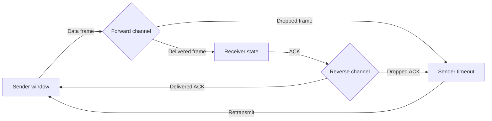

# Architecture

## Components

- `arq_simulator.protocols` implements the seeded discrete-time channel and
  sender/receiver state machines. It returns packet counts, loss and
  retransmission metrics, simulated duration, and a bounded event trace.
- `app.py` collects experiment parameters, runs all three protocol variants,
  and presents the resulting metrics using Streamlit.
- `tests/test_protocols.py` checks delivery, loss recovery, window behavior,
  and input validation without requiring the UI dependencies.

## Transfer flow

## Protocol distinctions

| Protocol | Sender window | Receiver behavior | Recovery |
|---|---:|---|---|
| Stop-and-Wait | 1 | Accepts only the next expected frame | Retransmit the outstanding frame |
| Go-Back-N | Configurable | Discards out-of-order frames; ACKs cumulatively | Retransmit all outstanding frames from the base |
| Selective Repeat | Configurable | Buffers out-of-order frames; ACKs each frame | Retransmit only expired outstanding frames |

The simulator uses absolute packet sequence numbers to avoid sequence-number
wraparound ambiguity. Time is discrete: sending a frame takes one time unit to
reach the receiver and one more for its ACK to return.
